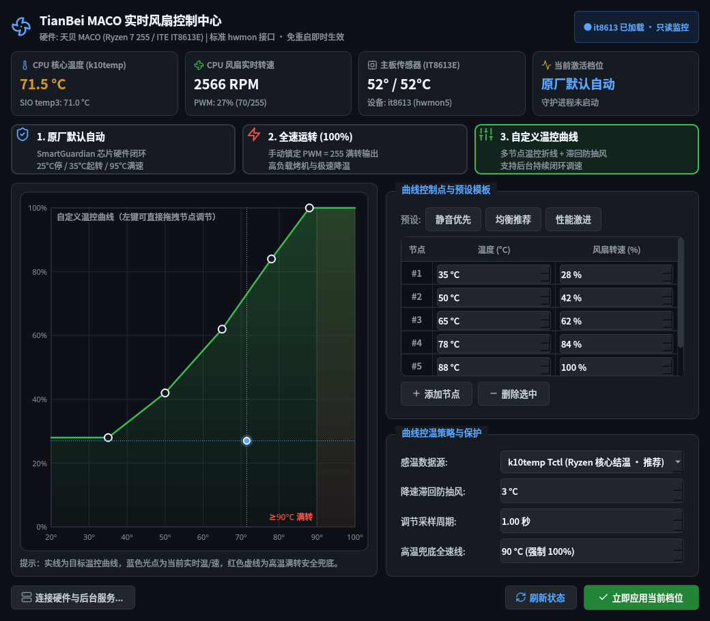

# 天贝 (TianBei) MACO 实时风扇控制中心 (`tianbei-fan-control-gui`)

专为 **TianBei MACO (AMD Ryzen 7 255 / ITE IT8613E)** 打造的 **免重启、标准 Linux `hwmon` 接口** 实时风扇控制软件（PyQt6 原生深色界面）。



## 为什么做这个项目？

原有的 [`tianbei-bios-control-gui`](https://github.com/Wandering233/tianbei-bios-control-gui) 通过修改 UEFI `efivars` NVRAM 生效，每次调整都需要重启电脑。  
本项目基于支持 **ITE IT8613E (`0x8613`)** 的 [`frankcrawford/it87`](https://github.com/frankcrawford/it87) 内核 `hwmon` 驱动，不从用户态直接敲端口寄存器，也不触碰 NVRAM：热加载驱动后即可通过标准 `/sys/class/hwmon/hwmon*` 实时调节风扇，切换瞬间生效。

## 三档核心模式

1. **原厂默认自动 (`auto`)**
   - 先复原 `IT8613E` 共用起始寄存器 `pwm2_auto_start = 70`，再切换 `pwm2_enable = 2`（芯片 SmartGuardian 硬件自动曲线：`25°C` 停转 / `24°C` 滞回 / `35°C` 起转 `PWM 70` / `3.0 PWM/°C` 斜率 / `95°C` 满速）。
   - 切换后完全由主板芯片硬件闭环控制，无需后台轮询。
2. **全速运转 (`full`)**
   - 切换 `pwm2_enable = 1` 并写入 `pwm2 = 255`（100% 占空比），适合性能压测、高负载渲染与快速降温。
3. **自定义温控曲线 (`curve`)**
   - 原生 `QPainter` 交互式曲线画布（支持鼠标直接拖拽节点、表格精确微调、内置「静音优先 / 均衡推荐 / 性能激进」模板）。
   - 由独立 root 守护进程 `tianbei-fan-daemon`（`systemd` 托管）读取 `k10temp Tctl`（或 `IT8613E temp3`）按滞回防抽风算法实时平滑调速，带 `≥90°C` 高温 100% 安全兜底与传感器异常全速保护。
   - **安全设计**：关闭图形窗口后，后台守护进程会继续按曲线运行；当守护进程停止时若处于自定义曲线模式，会自动恢复到「原厂默认自动」，避免风扇卡死在低转速。

## 权限与持久化设计

- **按需 GUI 提权（不改系统文件即可用）**：点击应用时若尚未连接后台，仅需通过桌面 `pkexec` 授权一次，即通过 `systemd-run` 拉起临时守护进程并加载 `driver/it87/it87.ko`；之后切换三档与编辑曲线都通过 `/run/tianbei-fan/control.sock` 秒级完成，不再反复弹窗。
- **可选开机自启持久化**：可在界面左下角【连接硬件与后台服务...】或执行 `./install.sh --with-service` 一键把编译好的模块安装到 `/lib/modules/$(uname -r)/updates/`（搭配 `/etc/depmod.d/`、`/etc/modprobe.d/`、`modules-load.d/` 与 `tianbei-fan-daemon.service`），开机自动恢复你选择的档位。

## 依赖环境 (Arch Linux 示例)

```bash
sudo pacman -S python python-pyqt6 base-devel linux-zen-headers polkit
# 若使用标准 linux 内核，请安装 linux-headers
```

## 安装与运行

```bash
git clone git@github.com:Wandering233/tianbei-fan-control-gui.git ~/Application/tianbei-fan-control-gui
cd ~/Application/tianbei-fan-control-gui
./install.sh

# 启动 GUI
tianbei-fan-control

# CLI 查看状态 / 快速切档
tianbei-fan-control --status
tianbei-fan-control --mode auto
tianbei-fan-control --mode full
tianbei-fan-control --mode curve
tianbei-fan-control --stop
```

## 开源许可与致谢

- `driver/it87/` 来自上游开源项目 [`frankcrawford/it87`](https://github.com/frankcrawford/it87)，遵循 **GPL-2.0** 协议（见 [`driver/it87/COPYING`](driver/it87/COPYING)）。
- 其余控制中心界面与守护进程代码遵循 **GPL-2.0-or-later** 协议。
